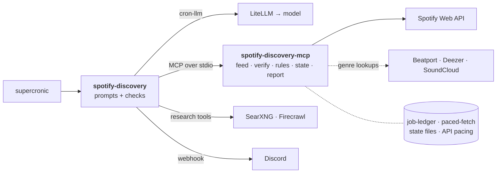

<div align="center">

# Spotify Discovery

**A new Spotify discovery playlist every day, one genre lane at a time, with a report on every pick.**


[Lanes](#lanes) · [How it fits together](#how-it-fits-together) · [What the model is asked](#what-the-model-is-asked) · [How a lane run goes](#how-a-lane-run-goes) · [How fast](#how-fast-and-how-often) · [Running it](#running-it) · [Configuration](#configuration) · [Development](#development)

</div>

Genre lanes for a Spotify discovery playlist, as scheduled jobs. Each lane run adds a few new tracks that fit the lane to today's playlist and posts a report to a Discord channel: what was added, from where, and why.

It's a plain scheduled job, not an agent:

- [spotify-discovery-mcp](https://github.com/wkbaran/spotify-discovery-mcp) runs as a child process. It creates or finds today's playlist, fetches new releases from the lane's known labels and artists, checks web finds on Spotify, drops anything already recommended, applies the lane's pick limits, adds the tracks, keeps all state and writes the report.
- [cron-llm](https://github.com/wkbaran/cron-llm) runs the research as a bounded tool loop and asks for the final choice with a JSON schema, through any OpenAI-compatible gateway that supports tool calling.
- The research tools are a [SearXNG](https://github.com/searxng/searxng) instance for search and a [Firecrawl](https://github.com/firecrawl/firecrawl) instance for reading pages, both self-hosted.

## Lanes

A **lane** is one genre slice of the day's playlist, with its own sources, its own taste description and its own memory. Each lane run adds a few tracks to the shared playlist and posts its own report.

The **lane id** is the lane's key in `lanes.json`: lowercase letters, digits, `-` and `_`, up to 41 characters. It's what you pass on the command line (`main.js deep-house techno`), and it names everything that belongs to the lane: its learned state (`lanes/<id>.json`), its run files (`runs/<id>-<time>.json`), its tracks in `history.json`, and its name in Discord (`Spotify · <id>`). Renaming a lane id starts that lane over, so pick ids you'll keep.

`lanes.json` sits in the state directory (`SPOTIFY_DISCOVERY_DIR`, `/data` in the container). You write it; the server never changes it, and reads it fresh on every run. A made-up example:

```jsonc
{
  "playlist": { "name": "{YYMMDD}" },            // the day's playlist; {YYMMDD} is e.g. 261018
  "defaults": { "feed_requests": 60, "feed_tracks": 18, "carry_days": 21 },
  "lanes": {
    "deep-house": {
      "name": "Deep and soulful house",
      "baseline": "Deep, soulful and jazzy house with warm chords and real vocals; late-night rather than peak-time.",
      "research": "Small labels release in bursts; a current EP from one beats several older singles.",
      "exclude": "Tech house, big-room vocal house, lo-fi beats.",
      "target": [3, 6],
      "labels": ["Example Records", "Another Label"],
      "artists": ["Some Artist"],
      "genres": ["Deep House"],
      "tags": ["deep house", "soulful"]
    }
  }
}
```

| Field | Used by | What it does |
|---|---|---|
| `name` | report, work list | The lane's title |
| `baseline` | research, choice | What the lane sounds like. It's the main thing the model judges a track against, so describe the sound, not just the genre name |
| `research` | research | Optional advice for the web search: how often the genre releases, where to look, what to favour |
| `exclude` | research, choice | Optional: what doesn't belong, even if it's close |
| `labels`, `artists` | feed | Seed sources: their new releases are offered every run, and research is told to look elsewhere. The lane adds more as it learns from picks (kept in `lanes/<id>.json`, not here) |
| `genres`, `tags` | genre check | When genre lookups are on (`SPOTIFY_DISCOVERY_METADATA`), a track whose Beatport or Deezer genre matches none of these is marked "⚠ genre outside this lane" for the model |
| `target` and the other limits | server | How many to pick, the mix of feed and web picks, the feed's request budget, how long unpicked tracks stay; see [spotify-discovery-mcp's README](https://github.com/wkbaran/spotify-discovery-mcp#the-rules). Set them per lane or under `defaults` |

The lane id and the descriptions say a lot about whose taste this is, which is why the real `docker/crontab` is gitignored and `lanes.json` lives only in the state directory.

## How it fits together



The job holds only the prompts and the checks on each answer. [cron-llm](https://github.com/wkbaran/cron-llm) gives it the model calls, the MCP client and the Discord post. The MCP server owns everything with consequences: the API, the state and the message layout, on [job-ledger](https://github.com/wkbaran/job-ledger) for state and [paced-fetch](https://github.com/wkbaran/paced-fetch) for API pacing. The model never touches state or the API directly. The other jobs ([substack-digest](https://github.com/wkbaran/substack-digest), [medium-digest](https://github.com/wkbaran/medium-digest)) have the same shape with a different server.

## What the model is asked

The model does two things in a lane run: research, the one open-ended step, and the final choice. Everything else (what's new from known sources, whether a track exists on Spotify, what was recommended before, the pick limits, the playlist and the report) is the server's.

**Research.** The model gets the lane brief (`baseline`, `research` note, `exclude`, the pick target, and the labels and artists already covered) and is asked to find 6–12 recent tracks **from artists and labels not on the covered lists**. That's the point of research: the known sources are already checked by code, so the model is there to find new names. It's told to:

- search label pages, Bandcamp, SoundCloud, Beatport, blogs, Reddit and artist pages, preferring releases from the last 6–12 months and smaller artists;
- **base every reason on someone's text** (a label or Bandcamp description, an artist statement, a reputable blog) and say whose it is. "Sounds like", "on listen" and "has a vibe" are banned: the model can't listen, so a reason it made up would be a guess dressed as a judgment;
- hand its finds to `verify_tracks` every few searches as plain lines (`artist | track | release | label | date | why, attributed | URL`), plus a line for any new label worth following. The server checks each on Spotify and answers ✓, pending (not out yet) or a reason it isn't usable.

The budgets (20 searches, 10 page reads, 8 `verify_tracks` calls) are in the prompt and enforced by the loop: a tool disappears from the model's list when its calls are spent. If fewer than 3 tracks verify, research runs once more, told which searches it already tried.

**The choice.** The model gets the server's review of everything pickable: verified web finds (`W`) with their attributed reasons, new releases from known sources (`K`), and tracks carried over from earlier runs (`C`), each with its label, date and, when a genre source knows it, a `Beatport:`, `SoundCloud:` or `Deezer:` genre line. It answers:

| Field | What it means |
|---|---|
| `picks` | The tracks that best fit the **baseline**, best first. The server keeps the order and drops from the end to meet the limits, so order is the model's real say. Fewer than the target is fine; don't pad with weak fits |
| `reject` | At most 3 `K` or `C` tracks that are **clearly the wrong genre** for the lane. These are never offered again. Not picking something is not a rejection: unpicked tracks carry over by themselves |
| `why` | Only for a `K` or `C` pick with a quoted or attributed reason. `W` picks already have the one research found |

On genre lines, it's told that "⚠ genre outside this lane" means the track doesn't fit unless the brief clearly supports it; that Deezer's genres are coarse (Folk or Rock is a real warning, Pop or Alternative without ⚠ isn't); and that a track with no genre line is one no source knew, so it mustn't guess the genre from the artist's name. This is the only call that thinks (`CHOICE_REASONING_EFFORT`).

The code then checks the answer: refs the review doesn't list are dropped and logged, only `K` and `C` refs can be rejected, and whether the run counts as thin comes from how many tracks verified, not from the model.

## How fast, and how often

Six lanes take about 20 minutes in all (3–4 minutes each on a local Qwen 27B through LiteLLM), against about 10–15 minutes a lane when the same lanes ran as Hermes agent jobs, spaced out over three hours. Almost all of that difference is generated tokens: the research loop runs with thinking off (`LLM_REASONING_EFFORT=none`), and the code makes the bookkeeping calls a Hermes main session spent turns on. Only the final choice thinks (`CHOICE_REASONING_EFFORT`), which adds about half a minute a lane. The server's feed stays inside a request budget, which keeps a day's lanes inside Spotify's daily Development Mode quota. Together that's what makes a playlist every day practical, where Hermes managed Tuesdays and Fridays.

## How a lane run goes

1. `discovery_begin` returns the lane brief (baseline, notes, limits, the labels and artists already covered) and the new releases from known sources. Since spotify-discovery-mcp 0.5.0 it checks those sources longest-waiting first and stops at a request budget, so a lane's Spotify cost no longer grows with every label it learns; see the server's README.
2. **Research**, the one open-ended step: the model searches the web, reads pages and hands its finds to `verify_tracks`, which checks each on Spotify. Budgets are enforced in code (by default 20 searches, 10 page reads, 8 `verify_tracks` calls): a tool disappears from the model's list when its calls are spent. If fewer than 3 tracks verify, research runs once more with different searches.
3. `discovery_review` lists everything pickable, from the server's records.
4. One structured call chooses the tracks, best first, and at most 3 to reject. This is the only call that thinks, when `CHOICE_REASONING_EFFORT` is set. The code drops refs the review doesn't list, rejects only K and C refs, and keeps reasons only for K and C picks.
5. `discovery_finish` applies the limits, adds the tracks and saves. The job then runs the server's `report` command, which prints each finished report once, and posts it.

Tracks that were shown but not picked aren't lost: the server keeps them in the lane's pool and offers them again (as `C` refs) for `carry_runs` runs, and web finds not yet on Spotify are re-checked each run until they appear.

A Spotify rate limit ends research at once (every tool then says so) and is reported instead of retried. An expired login or a rate limit at `discovery_begin` posts a one-line skip message. Anything else fails the run with a notice, and the lane's next run starts over.

## Running it

Give it one or more lane ids. Several run one after another, each starting when the one before ends and posting its own report under its own name (`Spotify · <lane>`), so one crontab line covers every lane. A lane that fails doesn't stop the others. An expired login or a Spotify block does, since the rest would hit it too, and one line lists the lanes left out.

```sh
npm install
npm run build
cp docker/.env.example .env                    # fill in
node --env-file=.env dist/main.js <lane id> [<lane id> …] --dry-run
```

`--dry-run` only stops `discovery_finish` from adding or saving: `discovery_begin` still finds or creates today's playlist and writes a run file, and research uses Spotify's quota.

Sign in to Spotify once with `npx spotify-discovery-mcp login` and point `SPOTIFY_DISCOVERY_AUTH` at the `auth.json` it writes. Lanes are defined in `lanes.json` in the state directory; see [Lanes](#lanes).

### In a container

`docker/` has a Dockerfile, a compose file and `crontab.example`. Copy it to `docker/crontab` (gitignored, since lane ids describe your taste) with your lane ids on one line, copy `docker/.env.example` to `docker/.env`, then:

```sh
docker compose -f docker/compose.yaml up -d --build
docker logs spotify-discovery     # one line per step, tool call and model call
```

The container runs as uid 1000; the state and auth directories should belong to it.

## Configuration

| Variable | |
|---|---|
| `LLM_BASE_URL`, `LLM_API_KEY`, `LLM_MODEL`, `LLM_REASONING_EFFORT` | The gateway and model (see cron-llm). The model must support tool calling. Requests are tagged `job:spotify-discovery` and `lane:<id>` |
| `DISCORD_WEBHOOK_URL` | Where reports go. Without it, they're printed |
| `DISCORD_FAILURE_WEBHOOK_URL` | Where failure notices go; defaults to the report webhook |
| `SEARXNG_URL`, `FIRECRAWL_URL`, `FIRECRAWL_API_KEY` | The research tools |
| `RESEARCH_SEARCHES`, `RESEARCH_PAGES`, `RESEARCH_VERIFY_CALLS` | Tool budgets (default 20, 10, 8), stated in the research prompt and enforced by the loop |
| `RESEARCH_TRACKS_MIN`, `RESEARCH_TRACKS_MAX`, `RESEARCH_MIN_VERIFIED` | How many tracks research aims for, and the fewest verified before a second pass (default 6, 12, 3). Fewer than the minimum also marks the run thin |
| `RESEARCH_MAX_TURNS` | Model turns in one research pass (default 40) |
| `CHOICE_REASONING_EFFORT` | `reasoning_effort` for the final choice alone, over `LLM_REASONING_EFFORT`. With `LLM_REASONING_EFFORT=none` for speed, `medium` here lets just the choice think (with Ollama and Qwen, anything but `none` turns thinking on) |
| `SEARCH_RESULTS`, `PAGE_CHARS` | Results per search and characters per page shown to the model (default 8, 8000) |
| `SPOTIFY_DISCOVERY_*`, `TZ` | Passed to spotify-discovery-mcp, and nothing else from the job's environment is. `SPOTIFY_DISCOVERY_DIR` defaults to `/data` and `SPOTIFY_DISCOVERY_AUTH` to `/auth/auth.json` |
| `JOB_DRY_RUN=1` | Same as `--dry-run` |

## Development

```sh
npm test
```

Node 26 or later. MIT licensed.
